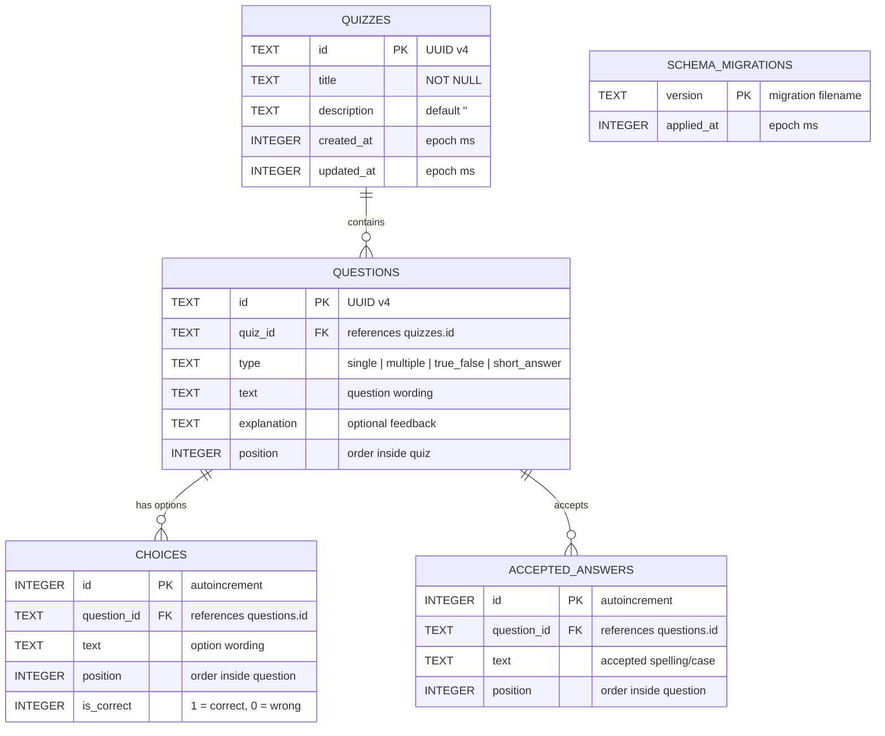

# JustQuiz — Database Design

SQLite database file: `data/justquiz.db` (overridable with `JUSTQUIZ_DB_PATH`).

The schema is normalised so every table can be inspected directly in DB Browser for SQLite. Questions belong to a quiz; choices and accepted answers belong to a question. Foreign keys are enforced and cascade on delete.



## Relationships

| Relationship | Cardinality | Delete behaviour |
|---|---|---|
| `quizzes` → `questions` | one-to-many | `ON DELETE CASCADE` |
| `questions` → `choices` | one-to-many | `ON DELETE CASCADE` |
| `questions` → `accepted_answers` | one-to-many | `ON DELETE CASCADE` |
| `schema_migrations` | standalone | internal bookkeeping only |

## Rules

- `questions.type` is restricted by a `CHECK` constraint to the four supported types.
- Choice-based questions (`single`, `multiple`, `true_false`) use `choices`; `is_correct = 1` marks the answer.
- `short_answer` questions use `accepted_answers` and have no choices.
- `correctIndices` in the app is reconstructed from the ordered `choices` rows where `is_correct = 1`.
- `acceptedAnswers` in the app is reconstructed from the ordered `accepted_answers` rows.
- Deleting a quiz removes its questions, choices, and accepted answers through cascades.
- Updating a quiz replaces its child rows inside one transaction; `created_at` is preserved.

## Indexes

| Index | Column | Purpose |
|---|---|---|
| `idx_quizzes_created_at` | `quizzes.created_at` | newest-first listing |
| `idx_questions_quiz_id` | `questions.quiz_id` | load a quiz's questions |
| `idx_choices_question_id` | `choices.question_id` | load a question's choices |
| `idx_answers_question_id` | `accepted_answers.question_id` | load a question's accepted answers |

## Readable view

`quiz_overview` joins the summary a reviewer usually wants:

```sql
SELECT * FROM quiz_overview;
```

| Column | Meaning |
|---|---|
| `id` | quiz UUID |
| `title` | quiz title |
| `description` | quiz description |
| `question_count` | number of questions |
| `created_at_utc` | readable creation time |
| `updated_at_utc` | readable update time |
