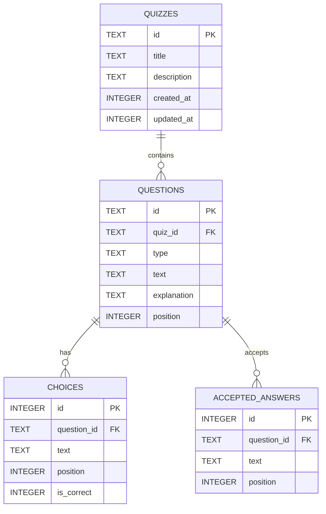

# Database Guide

JustQuiz stores all quiz data in a single SQLite file. There is no cloud database and no ORM.

| Item | Value |
|---|---|
| Engine | SQLite via Node's built-in `node:sqlite` (`DatabaseSync`) |
| Default file | `data/justquiz.db` |
| Override | `JUSTQUIZ_DB_PATH=./path/to/file.db` |
| Migrations | `db/migrations/*.sql`, tracked in `schema_migrations` |
| Access | `server/utils/quizRepository.ts`; inspect with any SQLite client |

## Entity-relationship diagram



`questions.type` is constrained to `single`, `multiple`, `true_false`, or `short_answer`. Foreign keys use `ON DELETE CASCADE`, so deleting a quiz removes its questions, choices, and accepted answers.

## Tables

| Table | Purpose | Notes |
|---|---|---|
| `quizzes` | One row per quiz | `id` is a UUID string; timestamps are epoch milliseconds |
| `questions` | One row per question | ordered by `position` within a quiz |
| `choices` | Choice text for single/multiple/true-false | `is_correct = 1` marks a correct option |
| `accepted_answers` | Accepted text for short-answer questions | one row per spelling/case variant |
| `schema_migrations` | Applied migration filenames | managed by the runner |

Indexes: `quizzes(created_at)`, `questions(quiz_id)`, `choices(question_id)`, `accepted_answers(question_id)`.

## View

`quiz_overview` provides a review-friendly summary:

```sql
SELECT * FROM quiz_overview;
```

It returns the quiz ID, title, description, question count, and readable UTC timestamps.

## Mapping rules

- `Quiz.questions` is reconstructed by selecting `questions` ordered by `position`.
- `Question.choices` is the ordered `choices.text` list.
- `Question.correctIndices` is built from rows where `is_correct = 1`, using their position in the ordered choice list.
- `Question.acceptedAnswers` is the ordered `accepted_answers.text` list.
- On update, all child rows for the quiz are deleted and reinserted inside one transaction; `created_at` is preserved.
- On insert, a supplied question ID is reused only if it is not already present; otherwise a fresh UUID is generated. A new quiz always receives a new UUID.

## Migrations

`server/utils/migrations.ts` creates `schema_migrations` and applies every pending `db/migrations/*.sql` file in filename order, each inside a transaction.

Migrations run automatically when the Nitro server starts. They can also be run manually:

```bash
pnpm db:migrate
```

To add a table or column, create the next numbered file (for example `002_add_tags.sql`); never edit an applied migration.

## Inspecting with DB Browser for SQLite

1. `pnpm db:reset`
2. Open `data/justquiz.db` in [DB Browser for SQLite](https://sqlitebrowser.org/).
3. Open the **Database Structure** tab to see tables, indexes, and the view.
4. Open the **Browse Data** tab and select `quiz_overview` or any table.
5. Run queries in the **Execute SQL** tab.

## Useful queries

```sql
-- Quiz summaries
SELECT * FROM quiz_overview;

-- Questions with their quiz title
SELECT q.title, qu.position, qu.type, qu.text
FROM questions qu
JOIN quizzes q ON q.id = qu.quiz_id
ORDER BY q.title, qu.position;

-- Correct options per question
SELECT question_id, text
FROM choices
WHERE is_correct = 1;

-- Row counts
SELECT 'quizzes' AS table_name, COUNT(*) AS rows FROM quizzes
UNION ALL SELECT 'questions', COUNT(*) FROM questions
UNION ALL SELECT 'choices', COUNT(*) FROM choices
UNION ALL SELECT 'accepted_answers', COUNT(*) FROM accepted_answers;
```

## Reset and seed

```bash
pnpm db:seed    # idempotent sample quiz
pnpm db:reset   # delete the file, migrate, then seed
```

The seeded quiz is `seed-world-capitals` (4 questions, 10 choices, 2 accepted answers).
